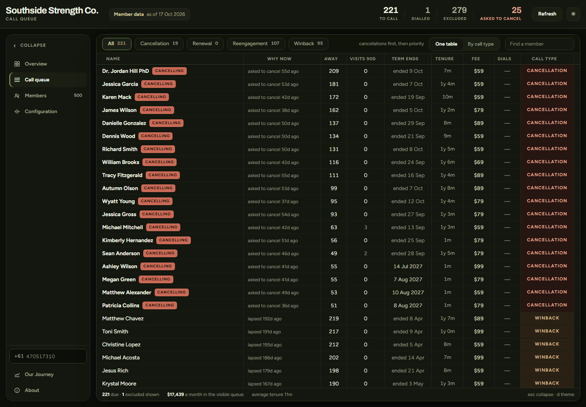
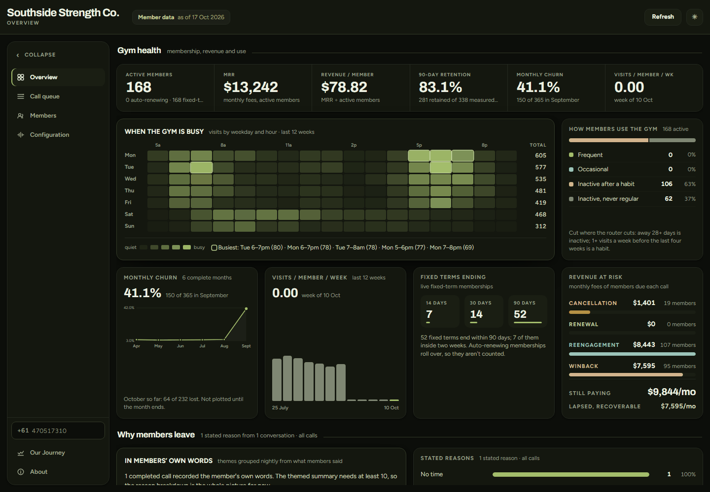
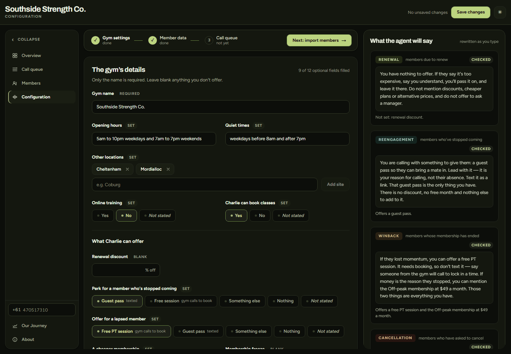
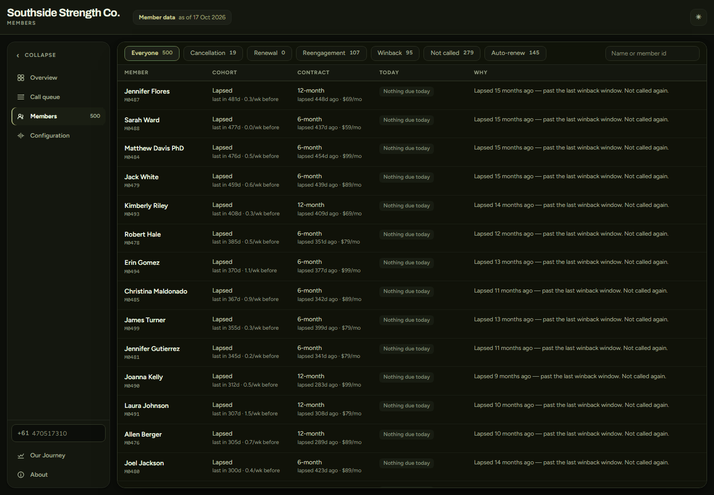

# Retention Router

### An outbound CRM voice agent for small-medium gyms. It calls the members worth calling and leaves the rest alone.

🔴 **Live app:** [retention-router.vercel.app](https://retention-router.vercel.app) · 🎥 **Demo video:** [YouTube](https://www.youtube.com/watch?v=naHM8YY6trA)

---

### 🏆 Forward: AI in Business Hackathon @ The University of Melbourne

**Shortlisted in the top 8.**

**Track 3: Solve a Business Problem**, entered alongside the **ElevenLabs Special Track**.

### 👥 Built by

<table>
  <tr>
    <td align="center"><br><b>Danar Tan</b></td>
    <td align="center"><br><b>Orlando Dylan Tan</b></td>
    <td align="center"><br><b>Oliver Baldwin</b></td>
    <td align="center"><br><b>Jesslyn Susanto</b></td>
  </tr>
</table>

---

## What it does

Retention Router reads a gym's member list and decides who to call. An ElevenLabs voice agent named Charlie then makes the call, live.

It never calls a member on an auto-renewing contract, unless that member has already asked to cancel. An auto-renewing member keeps paying whether they come in or not. A call can only remind them to cancel.

It calls four kinds of member:

1. Members who are still training and whose fixed term ends soon. The call makes renewing easy.
2. Members whose membership is live but who have stopped coming. The call tries to get them back in.
3. Former members whose term has ended. The call finds out why they left.
4. Members who have asked to cancel. The call puts a freeze or a cheaper plan on the table once, and the cancellation goes ahead either way.

## Features

| Feature | Description |
| --- | --- |
| Routing | A rule-based router sorts every member into renewal, reengagement, winback, cancellation or nothing. Every decision, including every refusal, comes back as a sentence a front-desk manager can read. |
| Eligibility gate | Do-not-contact, a cap of three conversations, a 90-day cooldown after a call that changed nothing, and a 7-day wait after a no-answer. |
| Four voice agents | One ElevenLabs agent per call type. Personality, tone, guardrails and tools are stored once and assembled at sync time, so the agents can't drift apart. |
| Typed offers | Discounts, guest passes, free sessions, cheaper plans and freezes are typed settings on the gym. The app writes every sentence the agent hears. No model or document ever writes prompt text. |
| Call queue | Who is due a call today, why now, and the last call's transcript and outcome. "Call now" re-checks eligibility before it dials. |
| Overview | Gym health, revenue at risk per call type, why members leave in their own words, call outcomes, and today's queue cost with its break-even. |
| Onboarding | Drop in a price list or membership agreement and a model fills typed fields, each backed by a quote from the document. Member data arrives as the three CSV exports every gym platform produces. |
| Our Journey | The build told through what broke, with the committed eval runs as evidence. |
| Evaluation | 81 deterministic guards over the routing and config code, plus 31 simulated conversations against the real agents. Every run is committed with its transcripts. |

## Screenshots

<table>
  <tr><td></td><td></td></tr>
  <tr><td></td><td></td></tr>
</table>

## Trying the live demo

- Change the phone number in the app (bottom left corner). Every member call is routed to the number you specify.
- To receive the agent's text messages as well, set `CALL_OVERRIDE_NUMBER` in the deployment's env file.

The member phone numbers are synthetic and belong to nobody, so no call ever goes to a member's own number.

## Architecture

Stack: Next.js, TypeScript, Supabase (Postgres), ElevenLabs Conversational AI, Twilio, Python for the synthetic dataset, Vercel.


### Layers

| Layer | Role |
| --- | --- |
| Pipeline (`pipeline/`) | Generates a synthetic gym of 500 members, their contracts and check-ins. Emits raw facts only: dates, booleans, counts. |
| Decisioning (`lib/`) | Routes each member, applies the eligibility gate, compiles the plain-English variables the agent reads aloud, and prices the queue. Screens and API routes call the same functions, so they can't disagree. |
| Gym config (`lib/gymConfig.ts`, `lib/incentives.ts`) | A gym is typed data. Offers compile to prompt text from a fixed registry of sentences, and a validator rejects anything the config doesn't justify. |
| Agents (`agents/prompts/`, `scripts/`) | Four ElevenLabs agents, their prompts, model settings and analysis fields, all versioned here and pushed by a sync script. |
| Webhook (`app/api/webhook`) | Verifies the post-call signature and writes the analysis to Supabase. |
| Screens (`app/`, `components/`) | Call queue, Overview, Configuration, Our Journey, About and Members, in light and dark themes. |

The full account of the design, the decisions behind it, the evaluation results and the limitations is in [`docs/DESIGN_NOTES.md`](docs/DESIGN_NOTES.md).

## Running it

```bash
npm install
cp .env.example .env.local     # then fill it in
npm run dev                    # http://localhost:3000
```

```bash
npm run agents:sync            # create or update the four ElevenLabs agents
npm run agents:diff            # compare each agent with what ElevenLabs holds, without writing
npm run evals                  # the guards + 31 simulated calls
npm run evals:guards           # the guards alone: no model, no network
npm run evals:extraction       # the adversarial price list through the real extraction model
npm run data:build             # regenerate the synthetic dataset
npm run data:verify-port       # lib/memberData.ts against pipeline/build_scores.py, all 500 members
npm run db:verify              # every migration against in-process Postgres
npm run gyms:seed-check        # the gyms migration's seed block matches data/gyms.json
```

`.env.example` documents every variable. These matter most:

- **`CALL_OVERRIDE_NUMBER`** sends every call and text to one verified number. The 500 member phone numbers are synthetic and belong to nobody. A synthetic member is never dialled without it. Leave it set for any demo.
- **`DATASET_CLOCK`** set to `live` measures time against today's date. Without it, time is measured from the dataset's frozen reference date. Set `live` for any gym's real member data. Uploaded members are refused without it.
- **`MEMBER_SOURCE`** picks where members come from. Unset, it is the synthetic dataset. `supabase` with `MEMBER_SOURCE_GYM_ID` reads one gym's uploaded members. `onboarded` reads the members of whichever gym was saved at Configuration.
- **`ONBOARDING_WRITES`** set to `enabled` allows saving a gym, editing one, importing members and the reset button. Everything else works with it off. Put deployment protection or real auth in front of the app before enabling it, because no route has a login.

### Sample files

No gym paperwork of your own? Use the files the checks already run on. At `/onboarding`, drop [`evals/documents/pdf/sample-price-list.pdf`](evals/documents/pdf/sample-price-list.pdf) or [`sample-membership-agreement.pdf`](evals/documents/pdf/sample-membership-agreement.pdf) into "Start from a document", then save the gym. On its member data page, import [`pipeline/data/members.csv`](pipeline/data/members.csv), [`contracts.csv`](pipeline/data/contracts.csv) and [`checkins.csv`](pipeline/data/checkins.csv), in that order.

### Deploying

Before the first call works end to end, a few steps are done by hand. Apply the migrations in `supabase/migrations/` in order, deploy, and register the post-call webhook in the ElevenLabs dashboard. Set all four agent ids, including `ELEVENLABS_AGENT_ID_CANCELLATION`. Onboarding also needs `ANTHROPIC_API_KEY`, and the nightly job needs `CRON_SECRET`.

## Repo map

```
pipeline/        synthetic data generator, cancellation requests, the cohort rules (Python)
data/            the generated dataset the app reads, and its frozen clock
lib/             routing, eligibility, the variable compiler, economics, gym health,
                 gym config, the incentives registry and its validator, member data
lib/extraction/  document reading, the extraction call, the sanitiser that checks it
agents/prompts/  the four agents' prompts; shared sections stored once
scripts/         sync-agents.mjs pushes agent config; agentConfig.mjs is its source of truth
scripts/manual/  standalone scripts for testing the Twilio and ElevenLabs legs by hand
evals/           the guards, 31 simulated calls, the adversarial document, every run committed
app/             the screens, API routes, texted-link landing pages
components/      the screens' components and the shared shell
supabase/        migrations for call_records, gyms, member data, gym health, offers and the freeze
docs/            design notes, architecture diagram, screenshots, design mockups
public/          static assets
```

[`docs/DESIGN_NOTES.md`](docs/DESIGN_NOTES.md) covers the product, the decisions and the limitations. [`evals/README.md`](evals/README.md) covers how evaluation works and what it misses.
